# 《量子力学的数学基础》勘误

凌复华译本 · 26 项勘误及修订意见 · 更新日期：2026-10-22

## 页码索引

[版本信息](#version-information) · [一、数学公式、符号及下标错误](#formula-errata) · [二、文字、语义与证明表述问题](#text-and-proof)

| 编号 | 书内页码 | 问题 |
| --- | --- | --- |
| [I-01](#i-01) | P23 | 正文代换式漏因子 |
| [I-02](#i-02) | P24 | 内积变量与括号 |
| [I-03](#i-03) | P27 | 定理 4 证明中的系数 |
| [I-04](#i-04) | P43 | 投影等范数条件的空间符号 |
| [I-05](#i-05) | P43 | 算子的标量乘法 |
| [I-06](#i-06) | P46 | 定理 17 证明中的字母与数字 |
| [I-07](#i-07) | P48 | 平方的位置 |
| [I-08](#i-08) | P52 | 酉算子证明中的内积 |
| [I-09](#i-09) | P67 | 谱投影之差中的等号误排 |
| [I-10](#i-10) | P71 | 向量的范数平方 |
| [I-11](#i-11) | P84 | 变换参数的下标 |
| [I-12](#i-12) | P85 | 谱族变量的多余撇号 |
| [I-13](#i-13) | P87 | 复共轭项指数的符号 |
| [I-14](#i-14) | P88 | 分母中的数字 1 与虚数单位 i |
| [I-15](#i-15) | P91 | 内积分隔逗号 |
| [I-16](#i-16) | P92 | 括号缺失 |
| [I-17](#i-17) | P102 | 向量的范数平方 |
| [I-18](#i-18) | P103 | 脚注 114 的正平方根谱积分 |
| [I-19](#i-19) | P113 | 斯蒂尔切斯积分的括号位置 |
| [II-01](#ii-01) | P24 | 连续性定义中的字母 |
| [II-02](#ii-02) | P27 | 有限正交系与等号条件 |
| [II-03](#ii-03) | P40 | 投影算子与投影后的向量 |
| [II-04](#ii-04) | P82 | 算子扩张关系的表述 |
| [II-05](#ii-05) | P128 | 第 3.4 节的错字 |
| [II-06](#ii-06) | P131 | 不确定性关系等号条件中的实数性质 |
| [II-07](#ii-07) | P140 | 物理量与表示算子的关系 |

## 版本信息

**书名：**《量子力学的数学基础》。

**原书名：** *Mathematical Foundations of Quantum Mechanics*。

**作者与译者：**（美）约翰·冯·诺依曼著，凌复华译。

**出版信息：**北京：科学出版社，2020.8；丛书：数学名著译丛。

**实物书版次与印次：**2020 年 8 月第 1 版；2025 年 1 月第 4 次印刷。

**截图版本与页码：**2020 年 8 月第 1 版，2020 年 9 月第 2 次印刷，PDF 共 278 页。下文 P23、P84 等均指书内印刷页码；图注另列 PDF 页序，二者相差 11 页。所有原页图（含 P84）均取自这一电子版。

**标注说明：**黄色高亮和橙框定位需修订之处。截图保留原印内容，仅叠加定位标记。

**ISBN：**978-7-03-065547-9。

**CIP 数据：**中国版本图书馆 CIP 数据核字（2020）第 106652 号；主题：量子力学；分类号：O413.1。

**开本、印张与字数：**720 × 1000，B5；印张：17 1/4；字数：348 000 字。

**版权页定价：**98.00 元。

**编辑与校对：**责任编辑：李欣、田轶静；责任校对：邹慧卿。

**印制与设计：**责任印制：赵博；封面设计：陈敬。

**印刷与发行：**保定市中画美凯印刷有限公司印刷；科学出版社发行，各地新华书店经销。

**出版社地址与邮编：**北京东黄城根北街 16 号；100717。

**出版社网址：**[www.sciencep.com](http://www.sciencep.com)。

**记号约定：**向量范数使用 $\|\cdot\|$，标量绝对值使用 $|\cdot|$；内积写作 $(f,g)$。

## 一、数学公式、符号及下标错误（19 项）

### I-01 · P23：正文代换式漏因子

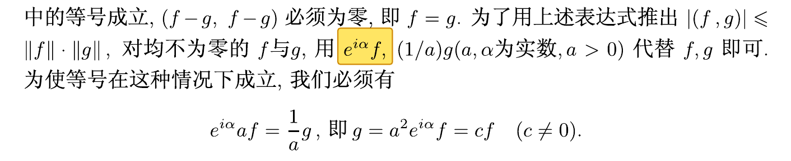

*I-01 原页局部：书内 P23，PDF 第 34 页。*

**原文记录：**在“对均不为零的 $f$ 与 $g$，用……代替 $f,g$ 即可”一句中，两项代换写为

$$
e^{i\alpha}f,\qquad \frac{1}{a}g\quad(a>0,\ \alpha\in\mathbb{R}).
$$

**改正：**

$$
ae^{i\alpha}f,\qquad \frac{1}{a}g\quad(a>0,\ \alpha\in\mathbb{R}).
$$

**说明：**第一项应补因子 $a$。同页随后独立列出的等式已为 $e^{i\alpha}af=\frac{1}{a}g$，并能推出 $g=a^2e^{i\alpha}f$；误排位于上方正文的代换式。

### I-02 · P24：内积变量与括号

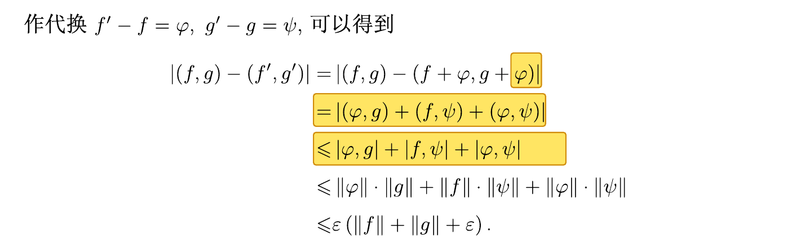

*I-02 原页局部：书内 P24，PDF 第 35 页。*

**原文记录：**

$$
(f+\varphi,g+\varphi).
$$

**改正：**

$$
(f+\varphi,g+\psi).
$$

**说明：**第二个变量中的 $\varphi$ 改为 $\psi$，并补全后续展开式的内积括号。规范展开为

$$
(f+\varphi,g+\psi)=(f,g)+(f,\psi)+(\varphi,g)+(\varphi,\psi).
$$

### I-03 · P27：定理 4 证明中的系数

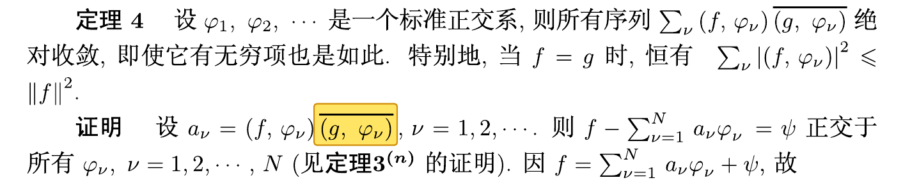

*I-03 原页局部：书内 P27，PDF 第 38 页。*

**原文记录：**

$$
a_\nu=(f,\varphi_\nu)\overline{(g,\varphi_\nu)}.
$$

**改正：**

$$
a_\nu=(f,\varphi_\nu).
$$

**说明：**删除多余的第二个共轭内积因子。本页另有完备性与等号条件的数学性修订，见 [II-02](#ii-02)。

### I-04 · P43：投影等范数条件的空间符号

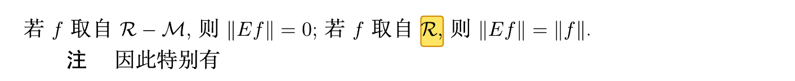

*I-04 原页局部：书内 P43，PDF 第 54 页。*

**原文记录：**若 $f$ 取自 $\mathcal{R}$，则 $\|Ef\|=\|f\|$。

**改正：**将 $\mathcal{R}$ 改为投影对应的闭线性流形 $\mathcal{M}$，即

$$
f\in\mathcal{M}\quad\Longrightarrow\quad\|Ef\|=\|f\|.
$$

**说明：**对到 $\mathcal{M}$ 的正交投影 $E$，有 $Ef=f$（当 $f\in\mathcal{M}$）；一般向量仅满足 $\|Ef\|\leq\|f\|$。

### I-05 · P43：算子的标量乘法

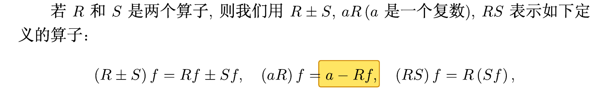

*I-05 原页局部：书内 P43，PDF 第 54 页。*

**原文记录：**

$$
(aR)f=a-Rf.
$$

**改正：**

$$
(aR)f=a(Rf).
$$

**说明：**右端为标量 $a$ 与向量 $Rf$ 的乘积，应删去误排的减号。

### I-06 · P46：定理 17 证明中的字母与数字

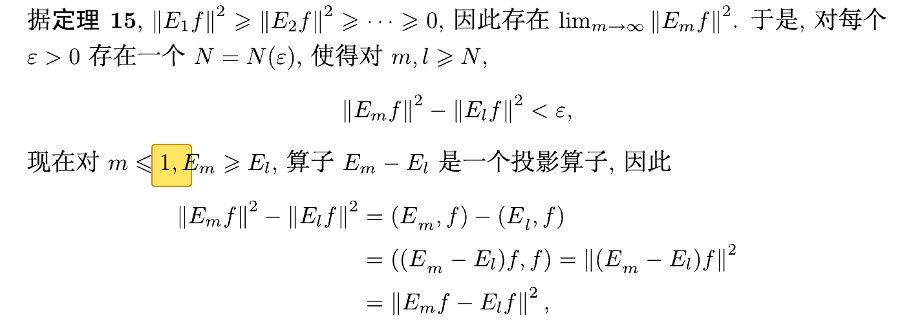

*I-06 原页局部：书内 P46，PDF 第 57 页。*

**原文记录：**$m\leq1$。

**改正：**$m\leq l$。

**说明：**数字 $1$ 改为小写字母 $l$。小写字母 $l$ 应与同段记号一致。

### I-07 · P48：平方的位置

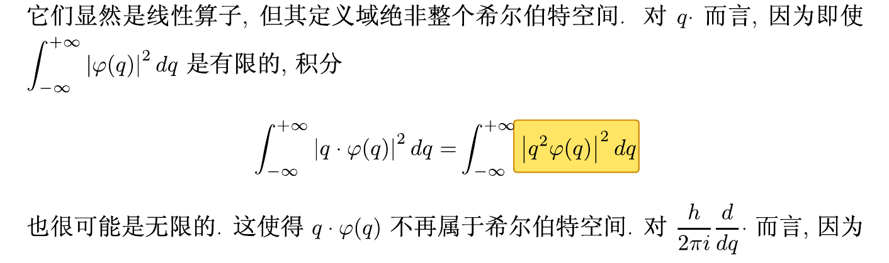

*I-07 原页局部：书内 P48，PDF 第 59 页。*

**原文记录：**

$$
\int_{-\infty}^{+\infty}|q^2\varphi(q)|^2\,dq.
$$

**改正：**

$$
\int_{-\infty}^{+\infty}q^2|\varphi(q)|^2\,dq.
$$

**说明：**对实变量 $q$，原式被积函数是 $q^4|\varphi(q)|^2$。若此处讨论乘法算子 $Q\varphi(q)=q\varphi(q)$ 的平方范数或定义域，则应使用改正式；本说明不将 $Q$ 与 $Q^2$ 的定义域混同。

### I-08 · P52：酉算子证明中的内积

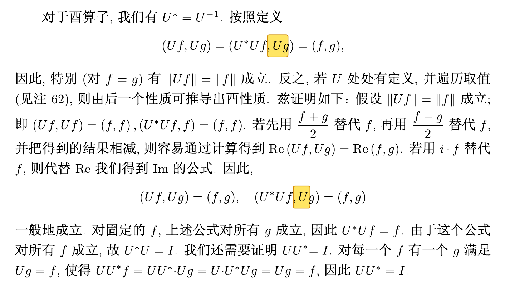

*I-08 原页局部：书内 P52，PDF 第 63 页。*

**原文记录：**

$$
(Uf,Ug)=(U^*Uf,Ug).
$$

**改正：**

$$
(Uf,Ug)=(U^*Uf,g).
$$

**说明：**右侧内积的第二个分量应为 $g$。同页下方重复出现的 $(U^*Uf,Ug)$ 也应作相同改正。酉性给出 $U^*U=I$，于是改正式进一步等于 $(f,g)$。

### I-09 · P67：谱投影之差中的等号误排

**性质：**已证实误排（电子版原页）。

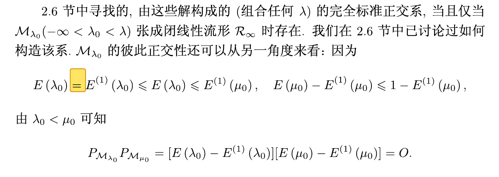

*I-09 原页局部：书内 P67，PDF 第 78 页。*

**原文记录：**

$$
E(\lambda_0)=E^{(1)}(\lambda_0)\leq E(\lambda_0)\leq E^{(1)}(\mu_0).
$$

**改正：**

$$
E(\lambda_0)-E^{(1)}(\lambda_0)\leq E(\lambda_0)\leq E^{(1)}(\mu_0).
$$

**说明：**仅把第一个等号改为减号，使左端成为谱族在 $\lambda_0$ 处的跳跃投影。附图直接显示电子版原印的等号。

**数学对照：**按 $E^{(1)}(t)=E(t-)$ 的谱族约定，当 $\lambda_0<\mu_0$ 时，跳跃投影应为 $E(\lambda_0)-E^{(1)}(\lambda_0)$，与下文不同本征子空间正交的论证一致。

### I-10 · P71：向量的范数平方

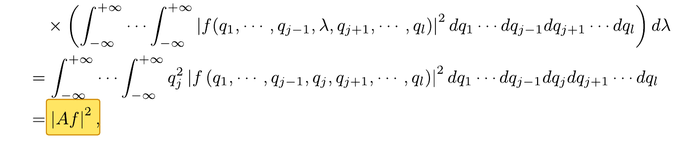

*I-10 原页局部：书内 P71，PDF 第 82 页。*

**原文记录：**谱积分计算末行写作 $|Af|^2$。

**改正：**

$$
\|Af\|^2.
$$

**说明：**$Af$ 是希尔伯特空间中的向量，此处统一使用向量范数。

### I-11 · P84：变换参数的下标

**性质：**下标符号误排，已对照电子版原页。

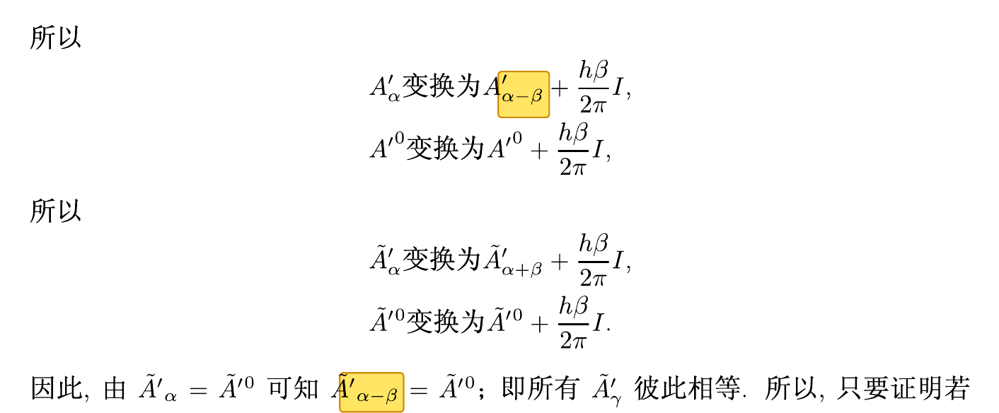

*I-11 原页局部：书内 P84，PDF 第 95 页。*

**原文记录：**第一组变换公式中写为

$$
A_{\alpha}^{\prime}\longmapsto A_{\alpha-\beta}^{\prime}+\frac{h\beta}{2\pi}I.
$$

**改正：**

$$
A_{\alpha}^{\prime}\longmapsto A_{\alpha+\beta}^{\prime}+\frac{h\beta}{2\pi}I.
$$

**说明：**将下标中的 $\alpha-\beta$ 改为 $\alpha+\beta$。同页下方“因此”一句中，$\widetilde{A}_{\alpha-\beta}^{\prime}=\widetilde{A}^{\prime0}$ 的相同下标也应对应改为 $\alpha+\beta$。附图分别标出这两处，并保留中间已经使用正号的变换公式作对照。

### I-12 · P85：谱族变量的多余撇号

**性质：**符号误排。

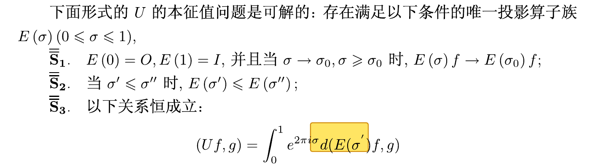

*I-12 原页局部：书内 P85，PDF 第 96 页。*

**原文记录：**条件 $\overline{\overline{S}}_3$ 的积分中，指数使用 $\sigma$，而谱族写成 $E(\sigma')$：

$$
(Uf,g)=\int_0^1 e^{2\pi i\sigma}\,d(E(\sigma')f,g).
$$

**改正：**

$$
(Uf,g)=\int_0^1 e^{2\pi i\sigma}\,d(E(\sigma)f,g).
$$

**说明：**删除谱族变量 $\sigma$ 的多余撇号，使其与同一积分中的变量一致。

### I-13 · P87：复共轭项指数的符号

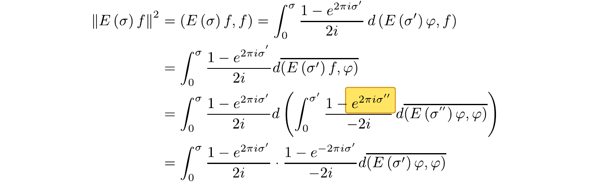

*I-13 原页局部：书内 P87，PDF 第 98 页。*

**原文记录：**复共轭积分展开中，对应指数项写为 $e^{2\pi i\sigma''}$，缺少负号。

**改正：**

$$
e^{-2\pi i\sigma''}.
$$

**说明：**当 $\sigma''$ 为实数时，$\overline{e^{2\pi i\sigma''}}=e^{-2\pi i\sigma''}$；取共轭应使指数中的 $i$ 变号。

### I-14 · P88：分母中的数字 1 与虚数单位 i

**性质：**字符误排。

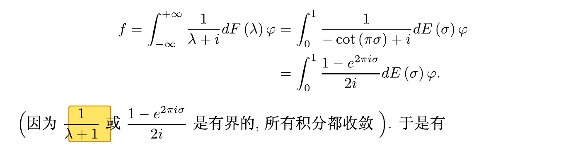

*I-14 原页局部：书内 P88，PDF 第 99 页。*

**原文记录：**关于积分收敛性的括注中写为

$$
\frac{1}{\lambda+1}.
$$

**改正：**

$$
\frac{1}{\lambda+i}.
$$

**说明：**将分母中的数字 $1$ 改为虚数单位 $i$，与同页上方已写出的 $1/(\lambda+i)$ 保持一致；当 $\lambda$ 为实数时，改正后的函数有界。

### I-15 · P91：内积分隔逗号

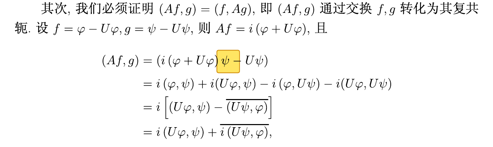

*I-15 原页局部：书内 P91，PDF 第 102 页。*

**原文记录：**

$$
(i(\varphi+U\varphi)\psi-U\psi).
$$

**改正：**

$$
(i(\varphi+U\varphi),\psi-U\psi).
$$

**说明：**补入内积两个分量之间的逗号。

### I-16 · P92：括号缺失

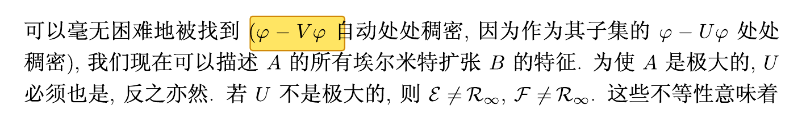

*I-16 原页局部：书内 P92，PDF 第 103 页。*

**原文记录：**第一行中，$\varphi-V\varphi$ 所在括号组缺少右括号。

**改正：**补齐为

$$
(\varphi-V\varphi).
$$

**说明：**原页第一行写为“$(\varphi-V\varphi$ 自动处处稠密”，右括号应补在第二个 $\varphi$ 之后。

### I-17 · P102：向量的范数平方

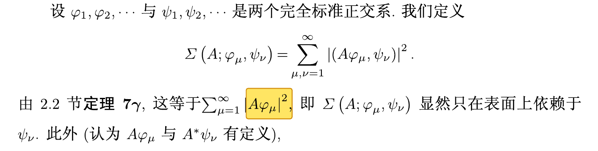

*I-17 原页局部：书内 P102，PDF 第 113 页。*

**原文记录：**$|A\varphi_\mu|^2$。

**改正：**

$$
\|A\varphi_\mu\|^2.
$$

**说明：**与 [I-10](#i-10) 相同，采用向量范数记号。

### I-18 · P103：脚注 114 的正平方根谱积分

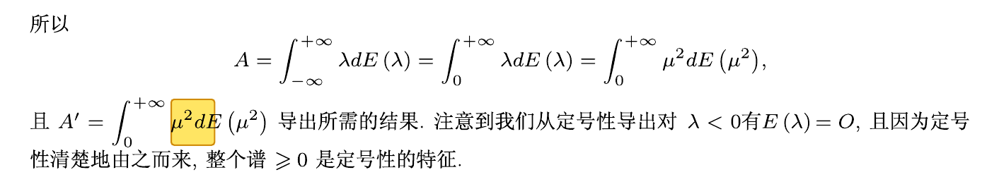

*I-18 原页局部：书内 P103，PDF 第 114 页。*

**原文记录：**

$$
A'=\int_0^\infty\mu^2\,dE(\mu^2).
$$

**改正：**

$$
A'=\int_0^\infty\mu\,dE(\mu^2).
$$

**说明：**在 $A$ 为非负自伴算子、$E$ 是其谱族，且 $A'$ 表示 $A$ 的正平方根这一上下文中，应将被积函数 $\mu^2$ 改为 $\mu$。令 $\lambda=\mu^2$，改正式对应

$$
A^{1/2}=\int_0^\infty\sqrt{\lambda}\,dE(\lambda).
$$

**数学对照：**原式对应积分函数 $\lambda$，给出的是 $A$；改正式才对应 $\sqrt{\lambda}$。这里采用谱测度积分的变量替换，不额外添入普通积分的雅可比因子。上述解释以本段列明的谱族约定为前提。

### I-19 · P113：斯蒂尔切斯积分的括号位置

**性质：**括号误排。

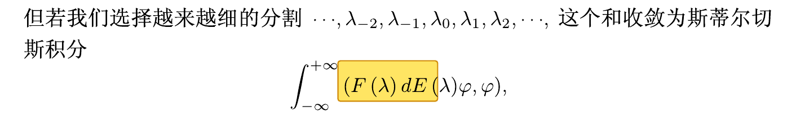

*I-19 原页局部：书内 P113，PDF 第 124 页。*

**原文记录：**页底积分的左括号印在 $F(\lambda)$ 前，原式为

$$
\int_{-\infty}^{+\infty}(F(\lambda)\,dE(\lambda)\varphi,\varphi).
$$

**改正：**

$$
\int_{-\infty}^{+\infty}F(\lambda)\,d(E(\lambda)\varphi,\varphi).
$$

**说明：**左括号应移至微分号 $d$ 之后，圈定标量函数 $(E(\lambda)\varphi,\varphi)$；$F(\lambda)$ 留作被积函数。

## 二、文字、语义与证明表述问题（7 项）

### II-01 · P24：连续性定义中的字母

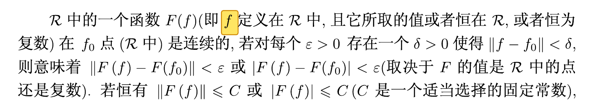

*II-01 原页局部：书内 P24，PDF 第 35 页。*

**原文记录：**“即 $f$ 定义在 $\mathcal{R}$ 中”。

**改正：**“即 $F$ 定义在 $\mathcal{R}$ 中”。

**说明：**将小写 $f$ 改为大写 $F$，使之与所定义的映射记号一致。

### II-02 · P27：有限正交系与等号条件

**性质：**数学性修订意见，不归为单纯排版错误。

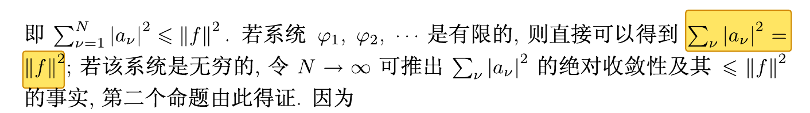

*II-02 原页局部：书内 P27，PDF 第 38 页。*

**原文记录：**定理 4 证明中称：“若系统 $\varphi_1,\varphi_2,\ldots$ 是有限的，则直接可以得到 $\sum_\nu|a_\nu|^2=\|f\|^2$”。

**建议改正：**对有限标准正交系 $\varphi_1,\ldots,\varphi_n$，令 $a_\nu=(f,\varphi_\nu)$，一般应写为

$$
\sum_{\nu=1}^{n}|a_\nu|^2\leq\|f\|^2.
$$

**等号条件：**

$$
\sum_{\nu=1}^{n}|a_\nu|^2=\|f\|^2\quad\Longleftrightarrow\quad f\in\operatorname{span}\{\varphi_1,\ldots,\varphi_n\}.
$$

**理由与适用范围：**有限并不自动意味着完备。取 $\mathbb{C}^2$ 中的 $\varphi_1=(1,0)$、$f=(0,1)$，左侧为 $0$，右侧为 $1$。一般不等式为贝塞尔不等式，完备正交系的相应等式为帕塞瓦尔等式。

**判定边界：**已对照本页定理 4 的陈述及其证明：所设仅为标准正交系，并未要求完备。因此，“有限”本身不足以推出等号。若另加完备性或 $f$ 属于张成空间的条件，等号才成立。

### II-03 · P40：投影算子与投影后的向量

**性质：**表述修订意见，不作为确定的字符误排。

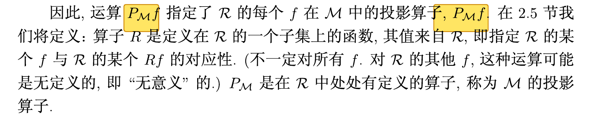

*II-03 原页局部：书内 P40，PDF 第 51 页。*

**原文记录：**“运算 $P_{\mathcal{M}}f$ 指定了……投影算子 $P_{\mathcal{M}}f$”。

**建议改正：**“映射 $f\mapsto P_{\mathcal{M}}f$ 定义了投影算子 $P_{\mathcal{M}}$”。

**说明：**$P_{\mathcal{M}}$ 是算子，$P_{\mathcal{M}}f$ 是该算子作用于向量 $f$ 后所得的向量，应在文字中区分二者。

### II-04 · P82：算子扩张关系的表述

**性质：**关系表述修订意见。

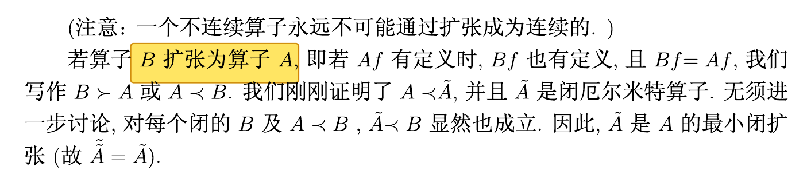

*II-04 原页局部：书内 P82，PDF 第 93 页。*

**原文记录：**“若算子 $B$ 扩张为算子 $A$”。

**建议改正：**“若算子 $B$ 是算子 $A$ 的扩张”。

**数学含义：**按此修订，关系为 $A\subseteq B$，即

$$
D(A)\subseteq D(B),\qquad Bf=Af\quad(f\in D(A)).
$$

**说明：**此修订明确谁是谁的扩张；最终含义应与该段实际使用的定义域包含关系一致，不宜只把“扩张为”视为一个无关数学含义的文字替换。

### II-05 · P128：第 3.4 节的错字

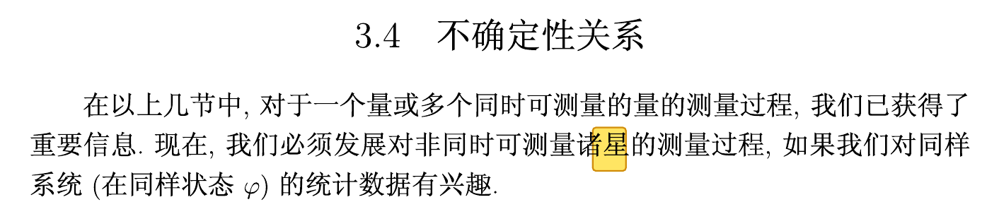

*II-05 原页局部：书内 P128，PDF 第 139 页。*

**原文记录：**“非同时可测量诸星的测量过程”。

**改正：**“非同时可测量诸量的测量过程”。

**说明：**仅将“星”改为“量”。

### II-06 · P131：不确定性关系等号条件中的实数性质

**性质：**语义与数学说明修订，不归为单纯符号误排。

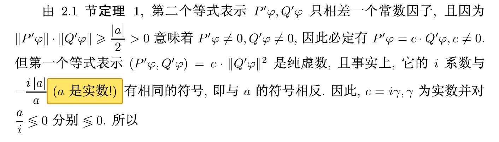

*II-06 原页局部：书内 P131，PDF 第 142 页。*

**原文记录：**在 $-i|a|/a$ 之后括注“$a$ 是实数！”。原书此处使用的是字母 $a$。

**建议改正：**明确写为“$-i|a|/a$ 是实数”，而不是说“$a$ 是实数”。此处所讨论的非零 $a$ 为纯虚数，前页已由交换子关系说明。

**必要前提与验证：**该分式要求 $a\ne0$。若 $a=it$，其中 $t\in\mathbb{R}\setminus\{0\}$，则

$$
-i\frac{|a|}{a}=-\frac{|t|}{t}\in\{-1,1\}\subset\mathbb{R}.
$$

**说明：**$a=0$ 时分式未定义，应在原证明中另行处理，不能直接套用上述写法。

### II-07 · P140：物理量与表示算子的关系

**性质：**文字表述修订意见。

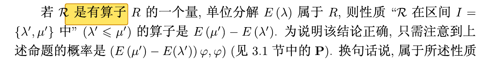

*II-07 原页局部：书内 P140，PDF 第 151 页。*

**原文记录：**“若 $\mathcal{R}$ 是有算子 $R$ 的一个量”。

**建议改正：**“若 $\mathcal{R}$ 是由算子 $R$ 表示的一个物理量”。

**说明：**补出“由……表示”的关系，使物理量与其表示算子的联系清楚。$\mathcal{R}$ 表示物理量，$R$ 表示相应算子。
